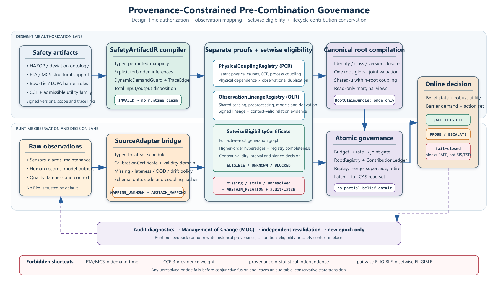

# 谱系依赖信念融合的生命周期一致组合前治理：注册表相对准入与根级贡献守恒

*Lifecycle-Consistent Pre-Combination Governance for Lineage-Dependent Belief Fusion: Registry-Relative Admission and Root-Level Contribution Conservation*

> **稿件性质（2026-08-16）。** 本文件是由现行主稿 `00-论文-中文阅读稿v21` 扩写而成的中文初稿，供通读、修改和后续英译。它不是 Information Fusion 可上传投稿包：正文仍为中文，作者与基金信息未填，正式比较实验尚未执行。主张、反例、条件保证和参考文献以 v21 为准；工程状态按 2026-07-31 机器清单更新。不得把本文中的解析算例或资格测试写成确认性结果。

---

## Highlights

- Transport-layer exactly-once can still inflate fused belief mass.
- Admission binds contribution, budget, availability, and action rights.
- Post-commit equivalence needs rollback, not message-key deduplication.
- Guarantees stay registry-relative and remain experimentally gated.

---

## 摘要

多源信念融合常把传输重试、派生视图、模型版本和异步重放当成不同消息，而这些消息可能只对应同一次物理采集。依赖组合、provenance、谱系编码和 exactly-once 流处理分别处理相关性、可追踪性、冗余祖先或传输重复，却没有自动规定：当两个已提交根事后被证明等价，或根经历 supersede、merge、retire 与 replay 时，非幂等信念组合中的认知贡献、预算和安全行动资格应如何原子重建。本文给出面向证据组合的 exactly-once 准入语义。它以物理采集事件为根，以相互独立的物理耦合注册表与观测谱系注册表提供组合资格，以一次根级联合映射形成唯一贡献，并以可重放账本在生命周期事件中保持根级贡献守恒。最小反例表明，两个具有不同消息键、却来自同一采集的简单支持函数即使各被传输层恰好处理一次，仍会把质量从 0.80 虚增至 0.96；事后等价合并需要撤销并重建认知状态，而不仅是消息去重。本文只给出注册表相对的条件保证，不把未知依赖自动判为独立，也不把接受分支的 \(1/\delta\) 界当作主要理论创新。当前仅完成窄工程资格：远程 SHK-000 通过 25 项测试与 16/16 canary，资源门失败，正式实验仍被阻塞。因此本文同时给出外部 oracle 驱动的最小机制实验与门控确认性设计，用于区分真实重复抑制、错误阻断和“永远拒绝”。

**关键词：** 信念函数；证据谱系；组合前治理；exactly-once；生命周期一致性；过程安全

## Abstract

Belief-fusion systems often treat transport retries, derived views, model versions, and asynchronous replays as distinct messages even when they originate from one physical acquisition. Dependence-aware combination, provenance, lineage encoding, and stream-processing exactly-once semantics address correlation, traceability, redundant ancestry, or transport duplication, but they do not specify how epistemic contribution, commitment budgets, and safety-action eligibility should be rebuilt when committed roots later become equivalent or undergo supersession, merge, retirement, and replay. This paper defines evidence-specific exactly-once admission for non-idempotent belief combination. Physical acquisition events act as roots. Separate physical-coupling and observation-lineage registries supply positive, registry-relative admission evidence. A single root-level joint mapper produces one contribution, and a replayable ledger conserves that contribution across lifecycle events. A minimal counterexample shows that two distinct transport keys from one acquisition can each be processed exactly once while duplicate simple-support functions inflate mass from 0.80 to 0.96. Correcting the state after post-commit equivalence therefore requires epistemic rollback and deterministic reconstruction, not message deduplication alone. Guarantees remain conditional on registry coverage, eventification, and mapping validity. The accepted-branch \(1/\delta\) bound is supporting analysis rather than the main novelty. The present SHK-000 run supplies only narrow engineering qualification: 25 tests and 16/16 canary checks passed, the resource gate failed, and no performance claim is supported. An external-oracle minimal mechanism experiment and a gated confirmatory design are specified to measure duplicate suppression, responsiveness to independent evidence, availability, and decision consequences.

**Keywords:** belief functions; evidence lineage; pre-combination governance; exactly-once semantics; lifecycle consistency; process safety

## 符号与缩略语

| 记号 | 含义 |
| --- | --- |
| root / view | 一次物理采集事件 / 由该事件产生的表达、派生或版本化视图 |
| \(\mathcal{E}(r)\) | root \(r\) 所在的可验证等价类 |
| SafetyArtifactIR | 过程安全工件经类型检查后的有限语义前端 |
| PCR / OLR | PhysicalCouplingRegistry / ObservationLineageRegistry |
| RootClaimBundle | 一个 canonical root 经一次联合 mapping 形成的唯一 joint valuation |
| \(\mathsf{X}_k\) | belief、registry、ledger、budget、gate 与 rate 的原子系统状态 |
| MME | Minimal Mechanism Experiment，非确认性的最小机制实验 |
| DRI / SRI | 冗余扰动不变性 / 独立信息响应 |
| IUT / SESOI | 交并检验 / 最小业务重要效应 |
| \((R_u^-,R_u^+,W_u)\) | 效用 \(u\) 下的风险下界、上界与宽度 |
| \(\mathcal{A}_i^*(t)\) | tick \(t\) 的可接受安全行动集合 |

## 1 引言

动态过程安全融合必须同时消化工艺偏离、屏障状态、报警、检维修记录、人工观察和派生分析 [3–7], [9–12], [24], [35], [46]。这类输入的困难不只是噪声或冲突。同一物理采集可以被多个 adapter、时间窗、模型和主体重新表达；两个起初被登记为独立的根，也可能在提交之后才由校准记录、总线拓扑或审计材料证明同源。对归一合取一类非幂等组合，消息被“各处理一次”并不等于物理信息“只贡献一次”。

信念函数理论已经为不确定证据提供了表示、组合和决策基础 [14–16]。后续工作分别处理非 distinct 证据、部分依赖、上下文折扣、时间衰减、未知相关和冲突告警 [17–23], [25], [27], [30–34], [37–44]。provenance 被用来解释组合过程并避免 double counting [13], [26]；PRIMEX-PEV 用可扩展编码保留谱系并删除冗余祖先 [36]；流处理系统则通过幂等键、checkpoint 和一致提交实现传输层 exactly-once [45]。这些成果构成直接近邻。本文因此不把 provenance、去重、event sourcing、Dempster 组合或“只计一次”单独宣称为新颖。

缺的是信念组合特有的生命周期一致准入语义。若 post-commit root equivalence、version replacement、merge、retire 或 replay 改变了“哪些消息代表同一认知贡献”，系统必须同步重建 belief、贡献账本、承诺预算、可用性和安全行动资格。普通传输幂等只能阻止同一键重复提交，不能判断两个不同键是否是同一物理信息。provenance 能记录来源，却不必规定等价发现后的原子撤销。依赖组合规则能保守合成，却不负责 root 身份和生命周期事务。

本文回答三个问题。第一，如何区分 transport exactly-once 与 epistemic exactly-once，并给出普通去重无法处理的最小反例。第二，如何在未知依赖保持 UNKNOWN 的前提下，只凭正向、可审计且声明完备的证据准入 root contribution，并在生命周期事件中保持贡献守恒。第三，如何用不读取本文内部 ledger 的外部 oracle 验证重复抑制、独立信息响应、错误阻断和决策后果，而不是用本文自己的表示为自己评分。

贡献及其当前证据状态如下。

| 贡献 | 内容 | 当前状态 |
| --- | --- | --- |
| C1：fusion-specific exactly-once semantics | 把 canonical root 的唯一认知贡献、post-commit equivalence、supersede、merge、retire、replay、预算与动作资格放入一个原子状态转换合同 | 规范化并有窄性质测试；尚未获得完整独立实现验证 |
| C2：正证据、注册表相对的组合前准入 | PCR 与 OLR 分离物理耦合和生成谱系；只有覆盖声明图的集合级证书可准入，缺失为 UNKNOWN | 条件命题；不保证真实世界注册表完备 |
| C3：表示中立的证伪路径 | 以外部 latent acquisition/ancestry oracle 构造 MME，并以 availability、false block、正确行动和资源门约束确认性主张 | 设计完成；未执行，不构成经验贡献 |

图 1 给出主链。过程安全工件只提供有限领域约束。原创性核心位于组合前准入和提交后生命周期重建，而不是工件本体本身。

**图 1. 从约束工件到生命周期一致融合。** SafetyArtifactIR、PCR/OLR、root-level mapper、SetwiseEligibilityCertificate、原子 ledger 和 safety latch 形成闭环。字段级 schema、路由枚举与失败码下沉至补充材料 S2-v20.1；正文保留问题、状态、反例、核心语义和可否证主张。

后文安排如下。第 2 节定位最近邻并划定增量。第 3 节给出问题模型和约束接口。第 4 节陈述准入语义、最小反例和生命周期转换。第 5 节给出条件实现命题与支撑性分析。第 6 节报告当前工程状态，并给出尚未执行的机制实验与确认性设计。第 7、8 节讨论边界并收束主张。

## 2 相关工作与研究定位

### 2.1 依赖信念组合与未知相关

Dempster–Shafer 理论与可转移信念模型提供了基本表示和决策工具 [14–16]。Dempster 组合要求可辩护的 distinct bodies of evidence；内容相似既不能证明同源，也不能证明独立 [17], [39]。cautious rule 处理非 distinct 证据 [18]；部分依赖组合和 ER/ERr-DE/ER-TLD 把依赖写成可估计参数 [20], [32], [33], [40], [41]；上下文折扣和时间衰减分别刻画可靠性与时滞 [19], [38]。IFNet 与 covariance-intersection 类方法处理未知相关 [25], [31]。冲突既可以被吸收，也可以被保留为告警 [22], [44]。这些方法主要改变“怎样组合”或“怎样保守估计”，并不定义 root 的版本、等价类或提交后回滚。

### 2.2 Provenance、谱系与 double counting

belief-function provenance 已被用于解释组合过程 [13]。provenance-aware trust assessment 直接以来源信息避免 double counting [26]。PRIMEX-PEV 用可扩展编码保留信息谱系、删除冗余祖先并支持异步更新 [36]。PROV-O 提供主体、活动、实体和派生关系的交换模型 [28]。来源行为解释进一步说明，观测者的偏差、延迟或欺骗会改变证据的决策后果 [27], [42]。因此，“使用 provenance”“传播 lineage”或“删除重复祖先”不是本文的新颖性。

本文关心的是时间顺序和事务后果。等价关系可能在两个 root 已经进入非幂等组合之后才成立；旧版本可能被新版本替换；多个 active roots 可能被 merge；root 可能在 retire 后触发 replay。此时 provenance 图只是证据。系统仍需要一个规范，决定撤销哪个 contribution、怎样重编译、怎样保留不可退款的历史 charge，以及何时禁止 SAFE 输出。

### 2.3 流处理 exactly-once 与融合缺口

大规模无界数据处理通过事件时间、触发器和一致状态提交，在正确性、延迟和成本之间取得平衡 [45]。该语义通常以事件键或 operator state 为边界。对信念融合，真正的重复单位却可能在消息到达后才由外部证据确定，并且两个不同消息键可以属于同一物理采集。本文借用事务纪律，但不把系统 exactly-once 重新命名为融合创新。需要验证的增量是：普通事件级 exactly-once 在 post-commit epistemic equivalence 下，是否仍产生不同于 unique-root oracle 的 belief 或行动。

### 2.4 过程安全约束前端

动态屏障、可达性分析和多源风险更新为高约束验证域提供了应用压力 [3], [4], [9–12], [24], [46]。ACCESS 与 Andromeda 把 assurance case 连接到异构工程工件 [5], [6]。FTA、Bow-Tie、LOPA、共同原因指南和 HAZOP 分别表达顶事件结构、危险路径、独立保护层、共同原因与偏差语义 [1], [2], [8], [10], [35], [47–50]。证据理论也已被用于表达故障树底事件的认知不确定性 [49]。这些工件不能自动证明观测独立或 Dempster distinctness。SafetyArtifactIR 因而只是有限语义前端：它约束 demand、barrier、loss 和禁止推理，不承担通用本体或独立性证明。

### 2.5 最近邻差异

| 最近邻 | 已解决 | 尚未自动解决 | 本文的可检验增量 |
| --- | --- | --- | --- |
| provenance-aware DS [13], [26] | 来源追踪、double counting 规避 | 提交后等价、版本替换和多状态原子重建 | post-commit equivalence 最小反例与 MME |
| PRIMEX-PEV [36] | 可扩展 lineage、冗余祖先消除、异步更新 | process/observation 双注册表、UNKNOWN 准入与 safety-action transaction | lineage-only 强基线 |
| transport exactly-once [45] | event/operator state 一致提交与重放 | 不同键之间的物理等价、认知贡献撤销 | 简单 event-sourced exactly-once 基线 |
| partial/cautious/unknown-correlation [18], [20], [25], [31], [40], [41] | 依赖或未知相关下的保守组合 | root identity、supersede/merge/retire/replay | 公共 oracle 和公共行动尺度比较 |
| safety-artifact frameworks [5], [6] | 工件连接、追踪和持续保证 | 工件语义如何限制信念准入 | 编译正负测试；领域增量单独检验 |

可成立的新颖性不是把已知组件并列。需要被反例否证的对象是一个组合语义：对非幂等信念融合，把 physical-acquisition root 的唯一认知贡献与其提交后生命周期绑定，并使 belief、ledger、budget、availability 和 action eligibility 在同一事务边界内重建。若简单 event-sourced baseline 在外部 oracle 下同样满足这些性质，C1 即不成立。

## 3 问题模型与约束接口

### 3.1 状态、根与威胁边界

系统处理的不是裸消息，而是带认证身份、物理采集区间、因果边界、adapter 版本和 mapping 证书的候选 view。canonical root 表示一次物理采集或独立观察事件。设备、人员或文件本身不是 root。同一设备在不同有效 epoch 可产生新 root；重采样、滑窗、摘要、转录和模型重跑默认继承原 root，除非有正向证据证明新的物理采集。

原子系统状态为

$$
\mathsf{X}_k=(\mathbb{B}_k,\ \mathrm{RootRegistry}_k,\ \mathrm{ActiveContributionLedger}_k,\ \mathrm{BudgetState}_k,\ \mathrm{GateState}_k,\ \mathrm{AcceptanceRateState}_k).
$$

威胁模型覆盖 exact retry、不同键重复、乱序、Sybil principal、版本轮换、post-commit equivalence、错误或遗漏 lineage、已登记或未登记共同原因、registry 污染、复杂度溢出和 replay 故障。签名与 hash 只证明身份和完整性，不证明观测真实。协议不防御持合法凭证的恶意主体，也不保证错误安全工件、错误 mapping 或遗漏共同原因。

### 3.2 Eventifier 与身份合同

冻结 Eventifier 按工况阶段、变化点规则和最大持续时间把连续流切成 acquisition epoch。签名 AcquisitionManifest 绑定 Eventifier 标识与版本、可信 clock domain、区间 \([t_{\mathrm{start}},t_{\mathrm{end}})\)、causal boundary、原始采集身份和分段证据；RootIdentityManifest 再绑定其 hash。Eventifier 的粒度不是天然真理。因此实验协议把 split/merge refinement 作为压力因子：在不改变底层物理 truth 的情况下改变分段，测量 belief、动作和 false-block 对 root 定义的敏感性。

可信 sequencer 以 \((\tau_k,\mathrm{message\_id})\) 形成全序。exact retry 由 canonical root、bundle version 和 envelope hash 的联合键识别。同版本异 payload 是 equivocation，而不是 duplicate。新增 root-equivalence edge 是版本化 control event；若它连接了已提交 roots，系统必须从最早受影响 checkpoint 重放。

### 3.3 根级映射与视图语义

SourceAdapter 把原始观测与质量标记映射为 typed feature、校准证书和 validity status。主路径的 RootLevelMapperManifest 冻结输入 schema、允许 view、联合校准集、适用域、代码或容器 hash 与失败策略，并由同一 sealed bundle 的全部有效 typed features 一次生成 RootClaimBundle \(\mathcal{V}_r\)。该 bundle 只允许一次进入全局 belief。各场景边缘只是查询视图。

本文不再宣称“加入任意语义等价 view 后 joint valuation 必然不变”。只有两类情形可验证。其一，exact duplicate、principal alias 或被 canonicalizer 明确消除的冗余 view 不改变输入集合。其二，新 view 改变 mapper 输入时，它必须形成更高 bundle version，并按 supersede 重编译整个 root，不能作为新的独立 contribution 叠加。若需要更强的 view-refinement invariance，必须对冻结 mapper 单独证明幂等；当前合同不默认该性质。

### 3.4 SafetyArtifactIR、PCR 与 OLR

过程安全前端输出危险场景、动态 demand guard、屏障角色、允许效用族、trace、PCR 与 OLR。FTA 和最小割集只提供顶事件结构支持；Bow-Tie 提供路径与屏障角色；LOPA 的 IPL independence 不等于 evidence distinctness；共同原因参数只进入物理生成模型；HAZOP 提供偏差本体，而不自动产生 Eventifier 阈值。每个输入必须被标记为 COMPILED、INTENTIONALLY_UNMAPPED 或 REJECTED。越权推理失败关闭。字段、失败码、完整状态机和 hash 合同见 S2-v20.1。

对候选 root \(o\)、活动 roots \(A_k\) 与上下文 \(c\)，组合只在签名集合级证书

$$
\mathsf{Eligible}(o;A_k,c)=1
$$

时发生。证书必须给出声明图覆盖清单、祖先闭包、高阶超边、已建模物理潜变量和最小见证子图。ELIGIBLE 的语义是“相对于冻结 registry、mapper 与声明完备性合同获得准入”，不是“统计上证明真实独立”。缺元数据、低检验功效、过期 edge、context mismatch 或 coverage gap 均保持 UNKNOWN。后续机制实验使用仅 scorer 可见的 oracle graph 注入漏边、伪边、高阶超边遗漏和错误 root merge，以量化该条件保证的脆弱性。

## 4 信念组合专用的 exactly-once 准入语义

### 4.1 准入与提交

设全局 belief 为 \(\mathbb{B}\)，候选 root 的唯一 joint valuation 为 \(\mathcal{V}_r\)。只有身份、mapping、集合资格、预算、速率、冲突和资源门全部通过时，才执行

$$
\mathbb{B}^+=\operatorname{NormConj}(\mathbb{B}^-,\mathcal{V}_r),
$$

并在同一可串行事务中写入 ledger、registry、budget、rate 与 gate state。任一 UNKNOWN 或失败只写具名 audit outcome，不新增 belief contribution。fail-closed 仅表示融合服务不得新增 contribution 或输出 SAFE_ELIGIBLE。它不表示物理装置已安全，也不替代 BPCS、SIS、ESD 或人工处置。

算法主链如下。字段级细节由 S2-v20.1 承担。

| 顺序 | 操作 | 不变量或失败语义 |
| --- | --- | --- |
| 1 | 认证 RootIdentityManifest 与 AcquisitionManifest | 身份失败只进 quarantine，不建立 root |
| 2 | 校验 envelope、版本、seal 与 exact retry | 同版本异 payload 拒收；exact retry 幂等 |
| 3 | SourceAdapter 与 root-level mapper | mapping 未知或漂移则不产生 contribution |
| 4 | 解析 root equivalence 与生命周期 | 已见 root 的高版本只走 supersede |
| 5 | 重建 setwise eligibility certificate | coverage 缺口保持 UNKNOWN |
| 6 | 预留 commitment、rate 与资源 | 失败不改变既有 active contribution |
| 7 | 组合并原子提交 \(\mathsf{X}_k\) | belief、ledger、budget、gate 同步 |
| 8 | 更新 latch 与 action eligibility | replay stale 或 provenance invalid 禁止 SAFE |

### 4.2 最小反例：为什么 transport exactly-once 不够

在识别框架 \(\Theta=\{H,\neg H\}\) 上，某次物理采集 \(a\) 产生简单支持函数

$$
m_a(\{H\})=0.80,\qquad m_a(\Theta)=0.20.
$$

同一采集经两个 adapter 形成不同消息键 \(k_1,k_2\)。若传输层保证每个键恰好提交一次，但系统暂时把它们登记为不同 roots，则无冲突合取后

$$
m_{k_1\oplus k_2}(\{H\})=1-(1-0.80)^2=0.96.
$$

unique-root oracle 仍是 0.80。此处没有消息重试：两个键都只处理了一次。也没有必须由冲突检测暴露的异常。后来审计证明 \(k_1\sim k_2\) 时，普通 idempotency key 只能说明两个事件均已提交，不能把 0.96 自动恢复为 0.80。仅记录 provenance 也不足以规定旧 contribution、预算与动作状态如何撤销。

本文语义把新增等价边视为 control event：收缩等价类，选择 canonical representative，从最早受影响 checkpoint 移除旧 member contributions，用 class-level mapper 生成至多一个 joint contribution，并原子重建 belief、ledger、budget、gate 与 action state。历史 processing charge 可审计且不退款，但当前 epistemic contribution 只能有一个。相同机制用于 version supersession。merge、retire 和 replay 不能以普通新消息进入组合。

该反例是必要性证明，不是充分的新颖性证明。MME 必须让简单 event-sourced exactly-once baseline、provenance/lineage baseline 和本文方法共同接受相同外部 truth，再比较输出。若基线同样恢复 unique-root oracle，C1 被否证。

### 4.3 生命周期状态转换

每个 root 的 lifecycle 仅取 UNCOMMITTED、ACTIVE、NONCONTRIBUTING、RETIRED 或 MERGED。尝试日志与有效版本分开。核心转换为：

- **INITIALIZE**：从未承诺 root 首次通过所有门后形成一个 active contribution。
- **SUPERSEDE**：更高版本替换同一 root 内容，复用既有 root slot，不增加独立信息量。
- **MERGE**：已确认等价的 roots 收缩为一个 class，删除成员旧 contribution 后重编译。
- **RETIRE**：root 退出活动集合并触发从 checkpoint 的确定性重建。
- **REPLAY**：只消费 FrozenExogenousContext 与 ImmutableChargeFacts，历史内生快照只供审计。
- **SAFE_HALT**：mandatory merge 或 replay 无法完成时，belief 标记 UNAVAILABLE，禁止继续服务过期状态。

commitment、acceptance-rate token 与当前 contribution 分离。历史实际 processing 或 commitment charge 不退款，防止通过版本轮换或 merge 逃逸预算。当前 belief 中的 contribution 则必须与 canonical class 一一对应。完整 CAS 读集、tie-break、timer、redirect 和失败码见 S2-v20.1。

### 4.4 行动边界与拒绝成本

SAFE_ELIGIBLE 除 belief 风险外，还要求独立安全链镜像正常且新鲜、provenance verified、replay current、gate accepted、无打开 safety latch，并对全部允许效用满足风险上界与宽度门。UNKNOWN、complexity overflow、mapping invalid 或 registry invariant failure 均不能输出 SAFE。

这种语义天然可能增加 abstention 和 false block。因此“重复贡献减少”不能单独构成系统优越性。必须同时报告良性 SAFE availability、误升级、正确行动延迟、miss mass、尾延迟、内存溢出和资源预算。若方法通过拒绝一切获得零 unsafe-SAFE，确认性 no-harm 门会使系统主张失败。

## 5 条件实现性质与支撑性分析

### 5.1 三个实现命题

**命题 1（Exact-duplicate and lifecycle conservation）。** 在身份绑定、root-level mapper、atomic commit 和 canonicalization 成功的执行域内，exact retry、principal alias 与 ledger replay 不增加当前 contribution；supersede 保持 root slot 数不变；merge 后每个 canonical class 至多保留一个 active joint contribution。该命题不声称任意新增 view 都保持 valuation 不变。

**命题 2（Replay/canonicalization equivalence）。** 对相同 FrozenExogenousContext、ImmutableChargeFacts 和全序事件前缀，规范在线执行与从合法 checkpoint 重放得到相同 effective registry、ledger、belief、budget、rate 和 gate state。缺失工件、canonicalization failure 或 cap overflow 进入显式 fail-stop，不属于成功域。

**命题 3（Registry-relative exclusion consistency）。** 若声明的 observation-generation graph、physical-coupling hypergraph、adapter/mapping 和 completeness contract 对目标执行域正确且覆盖充分，则获准组合不会由该声明图中已知的共同祖先或重复路径造成额外 contribution。该命题不是对真实独立性的无条件 soundness。漏边、伪边、错误 root merge 和错误 Eventifier 必须通过 oracle stress test 单独量化。

三个命题是架构和实现性质，而不是新的信念函数定理。补充材料 S1-v20.1 给出性质测试义务。实验协议要求独立 oracle 与第二实现进行 differential verification。若任一生命周期轨迹出现 class contribution 大于 1，核心架构直接否证，停止性能实验。

### 5.2 接受分支的支撑性 \(1/\delta\) 界

对固定操作数 \(b\)，令 \(s_b(q)=1-K_{\mathrm{norm}}(b,q)\)，\(F_b(q)\) 为归一合取的接受分支，并定义

$$
\mathcal{A}_{b,\delta}=\{q:s_b(q)\ge\delta\}.
$$

在有限框架且 \(\delta\in(0,1]\) 时，跨操作数与接受输入类的 \(L_1\) 一致 Lipschitz 常数为

$$
L_\delta^\star=
\sup_b\sup_{q\ne q'\in\mathcal{A}_{b,\delta}}
\frac{\|F_b(q)-F_b(q')\|_1}{\|q-q'\|_1}
=\frac1\delta .
$$

该结果沿用归一合取与随机集交的既有连续性工具 [30], [43]。本文仅把它用于冻结接受轨迹的敏感性审计。它不跨越 hard gate、supersede、merge、retire 或 replay，也不是本文主要理论创新。

若每一步先以单一遗忘率预测，且共同接受步的 survival mass 不低于 \(\delta_\star\)，则目标 root 内容替换导致的轨迹距离可按接受次数与遗忘时间形成上界。详细式与证明义务保留在 S1-v20.1。每个候选必须重新检查 gate margin，不能把一个时刻的界外推为未来安全证书。

### 5.3 保证边界与敏感性义务

实现命题依赖四个外部对象：Eventifier、root-equivalence evidence、registry coverage 和 root-level mapper。对应否证压力为：

1. 对同一 latent physical truth 改变 Eventifier 的 split/merge 粒度。
2. 随机删除或添加 lineage edge 与高阶 hyperedge。
3. 延迟 root-equivalence disclosure，覆盖 post-commit merge。
4. 加入不增加信息的 views 与真正独立 roots，分别测量不变性和响应性。
5. 使用独立实现和 scorer-only oracle，禁止从本文 ledger 读取真值。

只有在这些压力下同时保持 unique-root oracle 一致性和合理 availability，才能把“合同一致”升级为可发表的机制证据。

## 6 当前证据与分阶段验证设计

本节区分已经完成的工程资格和尚未执行的科学验证。前者不能写入效果结论。后者是投稿前硬门，不是已经获得的结果。

### 6.1 已完成的非确认性工程资格

远程 SHK-000 已在实际 NVIDIA L20 主机上完成窄资格：25 项工程测试通过，16/16 canary 检查通过。100 个 physical seed 产生 100 个不同 truth hash；固定 physical seed 的 10 个 noise seed 保持 1 个 truth hash 并产生 10 个 evidence hash；重复运行保持 hash 一致。该结果只支持 toy generator 的 seed/hash 隔离和一小部分 duplicate/root contract。

同一次执行的资源门失败。完整生命周期 runtime、第二实现和物理隔离仍未关闭。`PILOT_AUTHORIZED=false`，确认性测试分区未授权，权威标记为 `claim_support=none`。它没有验证完整 supersede/merge/retire/replay、独立实现等价、MME、功效、系统优越性或外部效度。

截至 2026-07-31，本地参考实现已注册完整方法面板，并完成事务生命周期、scorer-only 隔离和 7 个方法的非占位输出。与此同时，运行时冻结因后续源码修改而过期；容量、durable result、Archive A/B、重生成和 purge 的 live 证据仍未取得。正式实验准入文件不存在。因此本文不报告方法排名、延迟改善或安全收益。

公开过程数据中，Tennessee Eastman 扩展集 [29] 已被选作后续非确认性容量探测的代表性域。指定 HA4M、MIMII 阀门子域和 HM-SYNC 分片完成了归档完整性复核，但完整性不等于代表性验证，更不等于正式实验结果。

### 6.2 Phase 1：外部 oracle 驱动的最小机制实验

MME 是投稿前最低证据。它不使用确认性测试分区，也不能用于调节 SESOI、no-harm margin 或效应方向。scorer-only oracle 保存 latent physical-acquisition id、真实 ancestry graph、真实独立 root 与 action-relevant state。所有方法只见相同的 opaque events。

比较方法至少包括：完整方法 A；简单 event-sourced exactly-once baseline；provenance/lineage-only baseline（含 PRIMEX-PEV 型逻辑）；cautious 或 partial-dependence baseline；naïve normalized-conjunctive reference。操纵包括 exact retry、不同键同源 views、延迟披露的 post-commit equivalence、真正独立的新 root，以及对 registry 漏边或伪边、高阶边遗漏和 Eventifier split/merge 的压力测试。

对方法 \(m\) 的公共输出 \(g_m\) 定义冗余扰动不变性

$$
\mathrm{DRI}_m(k)=d\{g_m(X\cup D_k),g_m(X)\},
$$

其中 \(D_k\) 只增加重复或派生 views；并定义独立信息响应

$$
\mathrm{SRI}_m(k)=d\{g_m(X\cup I_k),g_m(X)\},
$$

其中 \(I_k\) 增加 oracle 证明独立的新采集。理想方法对 \(D_k\) 的 DRI 小，但对有决策意义的 \(I_k\) 仍有足够 SRI。主要评分统一使用 belief、credal-risk 和 action 输出与 unique-root oracle 的距离。A 的内部 canonical-root count 只作诊断，不能当裁判。

MME 同时报告 duplicate suppression、post-merge recovery error、false block、benign availability、wrong-direction action、decision delay、尾延迟、崩溃或内存溢出，以及 replay cost。若 A 只降低 DRI 却显著压低 SRI 或 availability，不能进入确认性主张。

### 6.3 Phase 2：门控确认性设计

目标总体限定为两个预签、结构不同的 barrier-explicit 放热 CSTR strata。它们是固定验证层，不代表从“拓扑总体”随机抽样。每个 topology 分别报告效应和交互，混合 estimand 使用预签权重。只有未来从冻结 topology generator 独立抽取足够多结构并设置 held-out family，才允许随机效应或拓扑总体外推。

主比较为 A 对在独立选择分区上按冻结规则选出的唯一 \(G^\star\)。每个功效 Monte Carlo replicate 重做选择。三个固定 sentinel baselines 进行 Holm 调整的支持性比较，用于检验 \(G^\star\) 脆弱性。winner stability 未过门时当前版本停止并升版，不在同一协议临时换 baseline。

共同主终点为：(i) unsafe-SAFE 或方法失败的复合风险，且两个组件各自 no-harm；(ii) 受限正确行动延迟。良性 SAFE availability、miss mass、误升级、拒判、barrier calibration、尾延迟和资源合同为绑定资格门。正确行动由独立安全团队在测试生成前双签规则清单、生成器与评分器代码及其 hash。bundle manifest 自动生成，执行全部机器资格和预签分层人工抽审，禁止逐 bundle 人工编辑。

### 6.4 交并检验、联合功效与预算可行性

系统通过事件是全部共同主效应和资格门的交集

$$
\pi_{\mathrm{joint}}=P\!\left(\bigcap_j E_j\right).
$$

不能用边际功效的乘积近似，除非通过事件独立。IUT 的复合零假设中只要至少一个组件为真，全部拒绝的概率即由单个组件的单侧 \(\alpha=0.025\) 控制，不在 IUT 组件间再做 Bonferroni 拆分。联合终点核必须同时纳入相关终点、批次组内相关、失败、miss mass、\(G^\star\) 选择和所有 gate，并用独立 power-confirm seed 复核一次。

预算硬门如下。若在冻结 nuisance grid 上不存在 \(n\le n_{\max,\mathrm{budget}}\) 使完整 gate 的功效下限达到目标，则系统主张标记为未检验，不得生成确认性测试分区。pilot 后不能在原协议删除终点以追求阳性；只能停止、升版并用独立数据验证较弱主张。

### 6.5 外部支持与措辞纪律

同一数值生态的两个 CSTR 只支持有限模拟域。扩展 Tennessee Eastman 数据 [29] 可承担公开故障窗、provenance 攻击和计算压力支持，但不能证明 barrier demand。投稿前至少需要独立 simulator、shadow 或硬件在环中的一项，且复用冻结的 root、registry 与 oracle 接口。人机协作或 6M 分类可作为未来异构可迁移案例，但分类本身不是方法创新，也不能替代 lifecycle MME。

结果措辞按门降级。只有性质资格成功时可声称合同一致。MME 成功可声称相对简单 exactly-once 或 lineage baseline 的机制增量。确认性 gate 全部通过才可声称系统收益。外部支持未完成时，题名、摘要和结论不得外推到通用工业或人机协作。

## 7 讨论

本文最容易被攻击的主张是：把 exactly-once 从消息处理边界推进到信念组合的认知贡献边界，并处理提交后才出现的 root equivalence。它不是新组合规则，也不是 provenance 或 event sourcing 的首创。发表价值取决于一次直接对撞。在相同外部 physical-acquisition oracle 下，普通 transport exactly-once、provenance/lineage-only 和依赖组合基线是否仍偏离 unique-root belief 或动作；本文方法能否在不过度拒绝的前提下恢复一致。

过程安全是高约束验证案例，不是原创性的唯一来源。SafetyArtifactIR 帮助把 demand、barrier、共同原因、lineage 与禁止推理分开，但其字段和失败码不应淹没主线。因此字段级规范下沉到 S2-v20.1。若过程安全消融不通过，该领域只能保留为应用域。若 lifecycle MME 不通过，即使安全工件编译正确，融合创新也不成立。

条件保证还有四个硬边界。第一，registry-relative 不是现实完备，隐藏漏边必须测。第二，Eventifier 决定 root 粒度，必须做 refinement sensitivity。第三，root-level mapper 对新增 view 未必幂等，不能泛化宣称 view invariance。第四，fail-closed 会牺牲 availability，必须用独立信息响应、false block、正确行动和资源 no-harm 共同约束。

当前稿仍不是可直接投稿的结果论文。Information Fusion 要求与现有方法比较、使用标准度量并报告结果。SHK-000 只证明代码从纯规范进入窄工程资格。真正改变编辑结论的节点是：完整生命周期 runtime、独立 oracle 与第二实现、MME 对近邻基线的机制优势，以及至少一个受控确认性或外部支持结果。在这些节点关闭之前，任何效果句都应删除。

## 8 结论

本文提出谱系依赖信念融合的生命周期一致组合前治理。其核心不是 provenance、去重或 Dempster 组合本身，而是面向证据的 exactly-once 准入语义：每个 physical-acquisition root 在非幂等组合中至多形成一个当前认知贡献，并在 post-commit equivalence、supersede、merge、retire 与 replay 中原子重建 belief、ledger、budget、availability 和 action eligibility。

最小反例说明，transport exactly-once 不能自动阻止不同消息键造成的 epistemic double counting。本文给出的保证严格限定为 registry、Eventifier 与 mapper 正确且覆盖充分的执行域。接受分支 \(1/\delta\) 界只是支撑分析。当前证据仅到窄工程资格，尚无性能或安全收益结论。独立 oracle 驱动的 MME、完整联合功效、availability/no-harm 与外部支持已被设为投稿前硬门。任何未过门的主张必须删除或降级。

## 数据与代码可用性

工作区已存在与现行合同部分对齐的参考实现资格切片，以及 SHK-000 的测试、canary、环境和审计工件。该切片只覆盖 seed/hash 隔离、候选完整性和部分 root/ledger 性质。完整 supersede/merge/retire/replay runtime、第二实现、MME、确认性数据和公共匿名复现包尚未完成。投稿前将公开 schema 与编译器、状态机、性质测试、生成器、容器、分析代码、冻结清单与可复现工件。当前版本不宣称已有公开数据集结果或完整 reference implementation。

## 伦理与安全声明

过程仿真和公开数据回放不得直接控制 BPCS、SIS、联锁、ESD、紧停或人员保护。独立安全链镜像只读记录外部状态。任何 shadow、硬件在环或人机协作研究必须另行完成伦理审查、作业安全分析、数据保护和独立安全监护。本研究未涉及人类受试者，也未使用可识别个人数据。

## 作者贡献

作者名单与 CRediT 角色待作者确认后补全。在确认前，本文不作为署名稿件使用。

## 利益冲突声明

作者声明：待作者确认。当前工作稿不包含已签署的利益冲突声明。

## 资助声明

待作者确认资助机构与项目编号。若无外部资助，投稿前改为无资助声明。

## 生成式 AI 使用说明

During the preparation of this work the authors used OpenAI Codex and xAI Grok to support literature organization, version comparison, language revision, outline expansion, and consistency checks. The authors reviewed and edited all outputs, verified the cited sources, formulas, code, and final statements, and take full responsibility for the content of the manuscript. No generative-AI system was used to create experimental results, figures intended for journal graphical abstracts, or unverifiable references.

## 参考文献

[1] International Electrotechnical Commission, IEC 61511-1:2016+AMD1:2017 CSV, Functional safety—Safety instrumented systems for the process industry sector—Part 1: Framework, definitions, system, hardware and application programming requirements, IEC, Geneva, 2017. https://webstore.iec.ch/en/publication/61289.

[2] International Electrotechnical Commission, IEC 61508-6:2010, Functional safety of electrical/electronic/programmable electronic safety-related systems—Part 6: Guidelines on the application of IEC 61508-2 and IEC 61508-3, IEC, Geneva, 2010. https://webstore.iec.ch/en/publication/5520.

[3] H. Sun, M. Qi, M. Yang, F. Wang, H. Wang, Multiparametric resilience assessment of chemical process systems incorporating process dynamics and independent protection layers, Process Saf. Environ. Prot. 197 (2025) 107018. https://doi.org/10.1016/j.psep.2025.107018.

[4] S. Yuan, M. Yang, G. Reniers, C. Chen, J. Wu, Safety barriers in the chemical process industries: A state-of-the-art review on their classification, assessment, and management, Saf. Sci. 148 (2022) 105647. https://doi.org/10.1016/j.ssci.2021.105647.

[5] R. Wei, S. Foster, H. Mei, F. Yan, R. Yang, I. Habli, C. O’Halloran, N. Tudor, T. Kelly, Y. Nemouchi, ACCESS: Assurance Case Centric Engineering of Safety-critical Systems, J. Syst. Softw. 213 (2024) 112034. https://doi.org/10.1016/j.jss.2024.112034.

[6] A. Retouniotis, Y. Papadopoulos, I. Sorokos, Andromeda: A model-connected framework for safety assessment and assurance, J. Syst. Softw. 220 (2025) 112256. https://doi.org/10.1016/j.jss.2024.112256.

[7] Y. Pan, L. Zhang, X. Wu, M.J. Skibniewski, Multi-classifier information fusion in risk analysis, Inf. Fusion 60 (2020) 121–136. https://doi.org/10.1016/j.inffus.2020.02.003.

[8] International Electrotechnical Commission, IEC 61882:2016, Hazard and operability studies (HAZOP studies)—Application guide, IEC, Geneva, 2016. https://webstore.iec.ch/en/publication/24321.

[9] A. Braniff, S.S. Akundi, Y. Liu, B. Dantas, S.S. Niknezhad, F. Khan, E.N. Pistikopoulos, Y. Tian, Real-time process safety and systems decision-making toward safe and smart chemical manufacturing, Digit. Chem. Eng. 15 (2025) 100227. https://doi.org/10.1016/j.dche.2025.100227.

[10] Center for Chemical Process Safety and Energy Institute, Bow Ties in Risk Management: A Concept Book for Process Safety, Wiley-AIChE, Hoboken, 2018. https://doi.org/10.1002/9781119490357.

[11] Y. Wang, Z. Ji, Y. Cao, S.-H. Yang, Dynamic risk assessment for process operational safety based on reachability analysis, Reliab. Eng. Syst. Saf. 253 (2025) 110564. https://doi.org/10.1016/j.ress.2024.110564.

[12] S. Yuan, G. Reniers, M. Yang, Dynamic-risk-informed safety barrier management: An application to cost-effective barrier optimization based on data from multiple sources, J. Loss Prev. Process Ind. 83 (2023) 105034. https://doi.org/10.1016/j.jlp.2023.105034.

[13] P. Kowalski, T. Martin, Provenance across evidence combination in theory of belief functions, Proc. 21st Int. Conf. Information Fusion (FUSION), 2018, 635–642. https://doi.org/10.23919/ICIF.2018.8455764.

[14] A.P. Dempster, Upper and lower probabilities induced by a multivalued mapping, Ann. Math. Stat. 38 (1967) 325–339. https://doi.org/10.1214/aoms/1177698950.

[15] G. Shafer, A Mathematical Theory of Evidence, Princeton University Press, Princeton, 1976. https://doi.org/10.1515/9780691214696.

[16] P. Smets, R. Kennes, The transferable belief model, Artif. Intell. 66 (1994) 191–234. https://doi.org/10.1016/0004-3702(94)90026-4.

[17] G. Shafer, The problem of dependent evidence, Int. J. Approx. Reason. 79 (2016) 41–44. https://doi.org/10.1016/j.ijar.2016.05.003.

[18] T. Denœux, Conjunctive and disjunctive combination of belief functions induced by nondistinct bodies of evidence, Artif. Intell. 172 (2008) 234–264. https://doi.org/10.1016/j.artint.2007.05.008.

[19] D. Mercier, B. Quost, T. Denœux, Refined modeling of sensor reliability in the belief function framework using contextual discounting, Inf. Fusion 9 (2008) 246–258. https://doi.org/10.1016/j.inffus.2006.08.001.

[20] M. Chebbah, A. Martin, B. Ben Yaghlane, Combining partially independent belief functions, Decis. Support Syst. 73 (2015) 37–46. https://doi.org/10.1016/j.dss.2015.02.017.

[21] A.-L. Jousselme, D. Grenier, É. Bossé, A new distance between two bodies of evidence, Inf. Fusion 2 (2001) 91–101. https://doi.org/10.1016/S1566-2535(01)00026-4.

[22] É. Lefèvre, Z. Elouedi, How to preserve the conflict as an alarm in the combination of belief functions?, Decis. Support Syst. 56 (2013) 326–333. https://doi.org/10.1016/j.dss.2013.06.012.

[23] T. Denœux, Decision-making with belief functions: A review, Int. J. Approx. Reason. 109 (2019) 87–110. https://doi.org/10.1016/j.ijar.2019.03.009.

[24] S. Yuan, G. Reniers, M. Yang, Dynamic and integrated safety and security barrier management: A new framework to manage major event risks in chemical plants, J. Loss Prev. Process Ind. 96 (2025) 105632. https://doi.org/10.1016/j.jlp.2025.105632.

[25] M. Wang, H. Liu, H. Tang, M. Zhang, X. Shen, IFNet: Data-driven multisensor estimate fusion with unknown correlation in sensor measurement noises, Inf. Fusion 115 (2025) 102750. https://doi.org/10.1016/j.inffus.2024.102750.

[26] B. Yu, S. Kallurkar, R. Flo, A Dempster-Shafer approach to provenance-aware trust assessment, Proc. 2008 Int. Symp. Collaborative Technologies and Systems (CTS), IEEE, 2008, 383–390. https://doi.org/10.1109/CTS.2008.4543955.

[27] P. Kowalski, M. Zocholl, A.-L. Jousselme, Explaining the impact of source behaviour in evidential reasoning, Inf. Fusion 81 (2022) 41–58. https://doi.org/10.1016/j.inffus.2021.11.007.

[28] T. Lebo, S. Sahoo, D. McGuinness (Eds.), PROV-O: The PROV Ontology, W3C Recommendation, 2013. https://www.w3.org/TR/prov-o/.

[29] C. Reinartz, M. Kulahci, O. Ravn, An extended Tennessee Eastman simulation dataset for fault-detection and decision support systems, Comput. Chem. Eng. 149 (2021) 107281. https://doi.org/10.1016/j.compchemeng.2021.107281.

[30] M. Loudahi, J. Klein, J.-M. Vannobel, O. Colot, New distances between bodies of evidence based on Dempsterian specialization matrices and their consistency with the conjunctive combination rule, Int. J. Approx. Reason. 55 (2014) 1093–1112. https://doi.org/10.1016/j.ijar.2014.02.007.

[31] S.J. Julier, J.K. Uhlmann, A non-divergent estimation algorithm in the presence of unknown correlations, Proc. American Control Conference, IEEE, 1997, 2369–2373. https://doi.org/10.1109/ACC.1997.609105.

[32] J.-B. Yang, D.-L. Xu, Evidential reasoning rule for evidence combination, Artif. Intell. 205 (2013) 1–29. https://doi.org/10.1016/j.artint.2013.09.003.

[33] X. Su, S. Mahadevan, P. Xu, Y. Deng, Handling of dependence in Dempster–Shafer theory, Int. J. Intell. Syst. 30 (2015) 441–467. https://doi.org/10.1002/int.21695.

[34] Q. Zhang, P. Zhang, T. Li, Information fusion for large-scale multi-source data based on the Dempster-Shafer evidence theory, Inf. Fusion 115 (2025) 102754. https://doi.org/10.1016/j.inffus.2024.102754.

[35] S. Guo, D. Gao, D. Lu, M. Wang, HAZOP knowledge graph construction: Dual optimization of ontology design and information extraction, J. Loss Prev. Process Ind. 99 (2026) 105814. https://doi.org/10.1016/j.jlp.2025.105814.

[36] K.-C. Chang, S.-M. Kuo, Y. Bar-Shalom, C.-Y. Chong, S. Mori, Encoding information lineage for scalable distributed fusion, J. Adv. Inf. Fusion 20(2) (2025) 152–171. https://isif.org/media/encoding-information-lineage-scalable-distributed-fusion.

[37] S. Barhoumi, I. Khanfir Kallel, É. Bossé, B. Solaiman, An empirical survey-type analysis of uncertainty measures for the fusion of crisp and fuzzy bodies of evidence, Inf. Fusion 121 (2025) 103106. https://doi.org/10.1016/j.inffus.2025.103106.

[38] Y. Song, X. Wang, L. Lei, Y. Xing, Credibility decay model in temporal evidence combination, Inf. Process. Lett. 115 (2015) 248–252. https://doi.org/10.1016/j.ipl.2014.09.022.

[39] P.P. Shenoy, On distinct belief functions in the Dempster-Shafer theory, Proc. 13th Int. Symp. Imprecise Probability: Theories and Applications, PMLR 215 (2023) 426–437. https://proceedings.mlr.press/v215/shenoy23a.html.

[40] P. Zhang, Z. Zhou, S. Tang, J. Wang, G. Hu, D. Zhao, Y. Cao, On the evidential reasoning rule for dependent evidence combination, Chin. J. Aeronaut. 36 (2023) 306–327. https://doi.org/10.1016/j.cja.2023.03.037.

[41] P. Zhang, Z. Zhou, Z. Feng, J. Wang, Y. Zhang, Inference and analysis on the evidential reasoning rule with time-lagged dependencies, Eng. Appl. Artif. Intell. 126 (2023) 106978. https://doi.org/10.1016/j.engappai.2023.106978.

[42] B. Kang, C. Zhao, Deceptive evidence detection in information fusion of belief functions based on reinforcement learning, Inf. Fusion 103 (2024) 102102. https://doi.org/10.1016/j.inffus.2023.102102.

[43] J. Klein, Complementary Lipschitz continuity results for the distribution of intersections or unions of independent random sets in finite discrete spaces, Int. J. Approx. Reason. 110 (2019) 164–184. https://doi.org/10.1016/j.ijar.2019.04.007.

[44] W. Liu, Analyzing the degree of conflict among belief functions, Artif. Intell. 170 (11) (2006) 909–924. https://doi.org/10.1016/j.artint.2006.05.002.

[45] T. Akidau, R. Bradshaw, C. Chambers, S. Chernyak, R.J. Fernández-Moctezuma, R. Lax, S. McVeety, D. Mills, F. Perry, E. Schmidt, S. Whittle, The Dataflow Model: A practical approach to balancing correctness, latency, and cost in massive-scale, unbounded, out-of-order data processing, Proc. VLDB Endow. 8(12) (2015) 1792–1803. https://doi.org/10.14778/2824032.2824076.

[46] S. Li, T. Cui, Robust factor information fusion for industrial safety through TSFD-Based phase space reconstruction and noise reduction, Inf. Fusion 128 (2026) 103917. https://doi.org/10.1016/j.inffus.2025.103917.

[47] W.E. Vesely, F.F. Goldberg, N.H. Roberts, D.F. Haasl, Fault Tree Handbook, NUREG-0492, U.S. Nuclear Regulatory Commission, Washington, DC, 1981. https://www.nrc.gov/reading-rm/doc-collections/nuregs/staff/sr0492/index.

[48] N. Khakzad, F. Khan, P. Amyotte, Dynamic safety analysis of process systems by mapping bow-tie into Bayesian network, Process Saf. Environ. Prot. 91 (2013) 46–53. https://doi.org/10.1016/j.psep.2012.01.005.

[49] G. Curcurù, G.M. Galante, C.M. La Fata, Epistemic uncertainty in fault tree analysis approached by the evidence theory, J. Loss Prev. Process Ind. 25(4) (2012) 667–676. https://doi.org/10.1016/j.jlp.2012.02.003.

[50] Center for Chemical Process Safety, Guidelines for Initiating Events and Independent Protection Layers in Layer of Protection Analysis, Wiley-AIChE, Hoboken, 2015. https://doi.org/10.1002/9781118948743.
