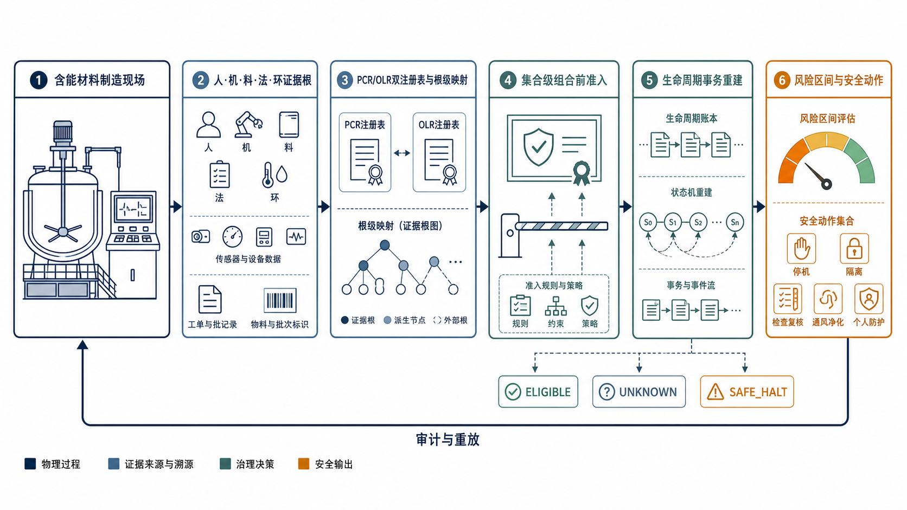

# 含能材料制造多源风险证据的生命周期一致组合前治理方法

**Lifecycle-Consistent Pre-Combination Governance of Multi-Source Risk Evidence in Energetic-Material Manufacturing**

**作者（待补）**

（作者单位、城市及邮编待补）

> 演示稿说明：本稿用于展示研究主线与《兵工学报》版式，不是正式投稿版。未完成的门禁、确认性实验和方法排名均未写成已获得结果。

## 摘要

含能材料制造现场的风险判断往往同时依赖工艺温压、设备状态、物料批次、操作行为、工单与环境量等多源信息。这些信息在系统中会经历采集、转换、滑窗、模型推理和异步重放，表面上是不同消息，实际上却可能只来自同一次物理采集。若直接将其送入非幂等信念组合，重复证据会被当作独立信息累加，进而改变风险区间与安全动作资格。针对这一问题，本文给出一种面向含能材料制造的生命周期一致组合前治理方法。方法以物理采集事件为证据根，将物理耦合注册表与观测谱系注册表分开维护，再由根级联合映射形成唯一认知贡献。只有当身份、谱系覆盖、物理耦合、映射资格、资源和冲突门同时满足时，候选根才能进入组合。对事后等价、替换、合并、退役与重放，系统通过可重放账本原子重建信念、贡献、预算、可用性和动作门。解析反例显示，同一采集的两个不同消息键即使各被传输层处理一次，也会将对命题 H 的质量由 0.80 虚增至 0.96；按证据根合并并重建后恢复为 0.80。该数值是确定性推演，不是性能实验结果。已归档的工程证据表明平台曾完成 369 项通过、13 项跳过的回归，但当前源树后续变更，运行时基线已标记为过期，正式实验仍处于阻塞状态。因此，本文的经验边界仅限于机制演示与工程可实现性，不支持方法排名或安全收益结论。

**关键词：** 含能材料制造；信念函数；证据谱系；组合前治理；生命周期一致性；安全系统工程

**中图分类号：** TJ55；TP391  　　**文献标志码：** A

**GB/T 13745—2009 学科分类：** 5352045（含能材料技术）；6202720（安全信息论）；6203070（安全系统工程）。

## Abstract

Risk assessment in energetic-material manufacturing draws on heterogeneous evidence from process variables, equipment health, material batches, human actions, work orders, and environmental measurements. These records are repeatedly transformed by adapters, windows, models, and replay services. Distinct messages may therefore represent a single physical acquisition. When they are fed directly into a non-idempotent belief-combination rule, duplicated evidence can be counted as if it were independent and may alter both risk intervals and safety-action eligibility. This paper presents a lifecycle-consistent pre-combination governance method for this setting. Physical acquisitions are treated as evidence roots. A Physical Coupling Registry and an Observation Lineage Registry are maintained separately, while a root-level joint mapper produces at most one epistemic contribution for each canonical root. Admission requires positive and auditable evidence for identity, lineage coverage, physical coupling, mapping qualification, conflict handling, and resource availability. Post-commit equivalence, supersession, merge, retirement, and replay are handled by atomic reconstruction of belief, contribution, budget, availability, and action-gate states. In a deterministic counterexample, two different message keys derived from one acquisition inflate the mass assigned to proposition H from 0.80 to 0.96 even though each key is processed exactly once. Root-level merge and replay restore the unique-root value of 0.80. This is an analytical demonstration rather than an empirical effect estimate. Archived engineering evidence records 369 passing and 13 skipped regression tests, but the source tree has since changed and the runtime baseline is currently stale. Formal experiments remain blocked. The evidence supports mechanism demonstration and implementation feasibility only; it does not support method ranking or claims of safety benefit.

**Keywords:** energetic-material manufacturing; belief functions; evidence lineage; pre-combination governance; lifecycle consistency; safety systems engineering

**图 1　含能材料制造多源风险证据的整体研究主线**

**Fig. 1　Overall research mainline for multi-source risk evidence governance in energetic-material manufacturing**

## 0 引言

混合、造粒、压制、包覆、干燥与转运等含能材料制造工序具有物料敏感、工艺状态变化快、人机交互紧密的特征。对风险的实时评估不可能只盯住一个传感器。温度、压力、振动、电流、湿度、批次检验、设备点检、人员操作、联锁状态和环境报警往往同时参与判断。难点不仅是噪声和冲突。同一次采集可能被不同接口重复转发，也可能被切成滑窗、摘要、模型评分和文本记录。若不追问“这些信息究竟来自哪一次物理事件”，系统很容易把重复表达当作独立证据。

Dempster–Shafer 证据理论及其可转移信念模型为认知不确定性建模提供了基础[1-3]。针对非独立证据，cautious rule、部分依赖组合、未知相关下的保守估计等方法已经较为成熟[4-7]。另一类工作从 provenance 和 lineage 出发，记录证据的生成与派生关系，用于追踪来源、删除冗余祖先或解释组合过程[8-10]。流处理系统的 exactly-once 机制则保证事件、检查点和算子状态的一致提交[11]。这些技术各自解决了一部分问题，但它们不会自动回答一个更细的事务问题：两个已经进入组合的证据根在事后被证明同源时，旧贡献、资源预算与安全动作状态应如何同步撤销和重建。

本文把问题收紧为“信念组合专用的认知层 exactly-once 语义”。所谓专用，并不是将消息队列的术语换一个名字，而是把物理采集根的唯一认知贡献与提交后生命周期绑定，使信念、账本、预算、可用性和动作资格在同一事务边界内改变。如果一个简单的 event-sourced 基线在外部 oracle 下能恢复与本方法一样的结果，核心主张就被否证。这一停止规则在设计时即被保留。

## 1 含能材料制造场景与证据问题

### 1.1 人机料法环五类证据

本文不把“人机料法环”当作五个彼此独立的信息源。它们只是制造现场的采集切面。人员操作时间戳可由控制系统日志、视觉识别和工单回填重复表达；设备振动的原始波形、频域特征和健康评分也可能共享同一次采集。物料批次标识、检验报告和投料记录之间同样存在派生关系。工艺规程、联锁逻辑和风险阈值属于“法”的约束性证据，不能和现场观测一样直接叠加。环境温湿度、粉尘和静电监测也可能因共用传感器或网关而相关。

因而，用证据类型直接代替物理来源是不可取的。证据根必须对应一次可鉴别的物理采集或独立观察事件，设备、人员、文件或模型本身都不是证据根。同一设备在不同有效时段可以产生新根；重采样、滑窗、摘要、转录和模型重跑默认继承原根，除非有正向证据说明它们来自新的物理采集。

### 1.2 威胁边界

系统需要对 exact retry、不同键重复、乱序、主体别名、版本轮换、事后等价、错误或遗漏谱系、注册表污染以及重放故障给出可观察的响应。签名和哈希只证明身份与完整性，不证明观测为真；合法凭据也不意味着主体不会作恶。本方法更不能代替制造设备的基本过程控制、安全仪表系统、紧急停车和现场处置。

## 2 生命周期一致组合前治理方法

### 2.1 证据根、派生视图与双注册表

系统通过冻结的 Eventifier 将连续工艺流切成 acquisition epoch，并使用 AcquisitionManifest 绑定切分规则、时间区间、时钟域、因果边界与原始采集身份。物理耦合注册表（Physical Coupling Registry，PCR）记录共用供能、共用传感器、同一批物料、共同环境激励与共因失效等物理联系。观测谱系注册表（Observation Lineage Registry，OLR）记录重采样、特征抽取、视觉转录、报表生成、模型版本和数据处理活动。两者不应混成一张含糊的关联图：生成谱系不等于物理耦合，物理耦合也不必然产生可见的派生链。

根级映射器将同一 sealed bundle 中的有效特征一次映射为 RootClaimBundle。一个 canonical root 在全局信念中至多形成一次贡献。新视图若只是明确的冗余表达，被 canonicalizer 消除；若它改变映射输入，必须形成更高 bundle version，整体替换旧贡献，不能作为第二份独立证据叠加。

### 2.2 集合级准入证书

设候选根为 o，当前活动根集为 A，上下文为 c。组合资格不由“未发现重复”推断，而由签名的集合级准入证书给出：

Eligible(o; A, c) = 1.

证书需要列出声明图覆盖、祖先闭包、高阶超边、已建模物理潜变量与最小见证子图。ELIGIBLE 只表示“相对于冻结注册表、映射器和声明完备性合同已获准入”，不是对真实世界独立性的统计证明。元数据缺失、过期边、context mismatch、覆盖缺口或检验功效过低时，状态保持 UNKNOWN。未知不会被默认改写为独立。

### 2.3 原子提交与贡献守恒

令全局信念为 B，候选根的唯一联合贡献为 V_r。只有当身份、映射、集合资格、预算、速率、冲突和资源门全部通过时，才执行

B⁺ = NormConj(B⁻, V_r).

组合结果、ActiveContributionLedger、BudgetState、GateState 和 AcceptanceRateState 在同一可串行事务中提交。任一检查为 UNKNOWN 或失败，系统只写审计结果，不增加信念贡献。“失败关闭”在这里的意思是融合服务不再输出 SAFE_ELIGIBLE，它不能被写成装置已经安全。

当控制事件说明两个已提交根等价，系统收缩等价类，选择 canonical representative，从最早受影响检查点移除旧 member contributions，并重算至多一个 class-level contribution。supersede、merge、retire 和 replay 沿用同一事务语义。事务违反、必需重建失败或重放不一致时，系统进入 SAFE_HALT，保留证据并停止对旧信念的安全许可。

### 2.4 风险区间与安全动作

针对温升、摩擦热、过载、静电积聚、屏障失效等危险命题，根级贡献被映射为信念与似然度边界，再经预先声明的效用族计算风险下界、上界与区间宽度。动作集可包含继续运行、降载、暂停投料、停机、隔离、通风净化、现场复核和个人防护升级。任何一个贡献的资格改变都可能改变可接受动作集，因而动作门必须与账本同步重建，不得在信念已回滚的情况下继续沿用旧的 SAFE 结论。

## 3 演示性验证设计

### 3.1 方法面板与外部 oracle

已实现的试验平台将完整生命周期方法记为 Proposed，并保留 B0—B5 方法面板：B0 为朴素归一合取，B1 仅依消息 id/version 去重，B2 只使用 provenance/lineage，B3 为 cautious rule，B4 为部分依赖强近邻，B5 为未知相关下的保守基线。所有方法读取相同事件流、资源上限、deadline 与动作 schema，Proposed 不能独享 truth。

评分器使用仅 scorer 可见的 truth graph，保存 physical acquisition id、真实 ancestry、共因激活和 action state。方法只获得 declared graph 和不透明令牌。这种分离避免用方法自己的账本数量为方法评分，也使漏边、伪边、高阶超边遗漏和错误根合并成为可控压力因子。

### 3.2 最小解析反例

在辨识框架 Θ={H,¬H} 上，某次物理采集 a 对 H 给出简单支持：

m_a({H})=0.80， m_a(Θ)=0.20。

同一采集经两个 adapter 形成不同消息键 k₁ 和 k₂。传输层可以保证每个键只提交一次，但若组合层把它们当作两个独立根，无冲突合取后有

m_k₁⊕k₂({H}) = 1-(1-0.80)² = 0.96。

unique-root oracle 仍为 0.80。数值上的 0.16 偏移不是统计效果量，只是一个可复算的反例。它说明 transport exactly-once 不等于 epistemic exactly-once。当新的 root-equivalence edge 证明 k₁∼k₂ 时，必须撤销旧的两份贡献并重建为一份，结果才回到 0.80。

### 3.3 机制指标与停止规则

对不增加新物理信息的重复或派生视图 D_k，定义冗余扰动不变性 DRI；对 oracle 证明独立的新根 I_k，定义独立信息响应 SRI。主评分使用与 unique-root oracle 的信念距离、可信风险偏差、动作集不一致和 post-merge recovery error。良性可用性、false block、错误方向动作、P99 延迟、内存与重放成本是约束指标。方法内部的 ledger count 只作调试，不进入主要比较。

若 Proposed 的距离改善只是因为更多拒绝、更高弃权或它自己定义的 root count，机制主张判为失败。若简单 event-sourced 基线在外部 oracle 下同样完成 post-commit 等价恢复，也应终止将该机制作为独立创新。这个判据比“趋势较好”更苛刻，也更接近工程判断的实际。

## 4 结果与讨论

### 4.1 可复算的机制结果

表 1 汇总最小反例。它只比较“同一物理采集被表达两次”时的确定性结果，不包含抽样误差。朴素合取的输出高于 unique-root oracle；生命周期重建后与 oracle 一致。不过，这个例子不能证明方法在高冲突、注册表漏边或长时延重放下仍然占优。

**表 1　同源双键的最小解析演示（非性能实验）**

| 处理方式 | 有效物理根数 | m({H}) | 相对 unique-root oracle 偏差 |
| --- | ---: | ---: | ---: |
| unique-root oracle | 1 | 0.80 | 0.00 |
| 不同键各提交一次后朴素合取 | 2（误判） | 0.96 | +0.16 |
| 等价发现后根级合并与重建 | 1 | 0.80 | 0.00 |

### 4.2 已归档工程证据与当前状态

平台已归档的运行时证据包含 B0—B5 与 Proposed 的 7/7 方法注册、truth isolation 负测、事务账本以及方法输出。证据冻结点的 Windows CPython 3.11.9 全量回归记录为 369 passed、13 skipped，跳过项主要与 Windows 符号链接权限有关。源树后续发生了变更，因而当前 `runtime_gate` 不能继续引用原基线，机器状态已标为 `STALE_SOURCE_MODIFIED_20260731`。

与此同时，segment-cap、durable-result、Archive A/B、regeneration 和 purge 五类 live gate 均未闭合，`FORMAL_STAGE_ADMISSION-v6.13.json` 不存在，总状态为 `FORMAL_EXPERIMENT_BLOCKED`。开发 fixture 或组件 QA 可以证明实现路径可运行，却不能替代新鲜的 live-segment 证据。因此，本稿没有将回归测试数量换算为算法准确率，也没有构造方法排名。

**表 2　项目证据状态与可用结论边界**

| 证据层 | 已有证据 | 当前可用结论 | 不可推出的结论 |
| --- | --- | --- | --- |
| 解析机制 | 0.80→0.96→0.80 可复算反例 | transport 去重不足以处理认知同源 | 真实生产效果量 |
| 工程实现 | 归档的 369 passed、13 skipped 与 7/7 面板 | 曾具备窄工程资格 | 当前源树的有效基线 |
| 门禁证据 | 五类 live gate 仍 PENDING | 正式实验被阻塞 | 确认性结果、方法排名 |
| 应用外推 | 含能材料制造场景映射 | 形成可检验的应用方案 | 安全收益、事故率降低 |

### 4.3 对含能材料制造的意义

含能材料现场的一个典型问题是“多系统同看一件事”。比如，搅拌机电流突增会同时进入 PLC 报警、设备健康模型和工艺风险模型；巡检员的复核记录又可能引用同一段趋势图。若三者平行投票，并不意味着存在三份独立物理证据。根级治理使这种派生关系先于组合被审核，减少信念异常尖锐的机会。

另一方面，系统不能因害怕 double counting 而拒绝一切新证据。物料复检、独立热电偶、现场人工观察与安全联锁反馈可能真的增加了新信息。SRI、benign availability 和 false-block 指标正是为了防止“永远 UNKNOWN”成为看似安全的伪解。只有在重复抑制与独立信息响应之间都保持可接受表现，方法才有进入更高层试验的理由。

### 4.4 局限性

本方法的保证是注册表相对且有条件的。PCR/OLR 可能漏掉共因，Eventifier 可能过分切分或错误合并，根级映射也可能因校准漂移产生不正确贡献。这些问题不能通过一张签名证书消失。注册表压力试验、split/merge 敏感性分析与独立 oracle 因而是必要的。

现有代码和门禁证据也还没有闭合。历史回归能够说明实现层曾经达到一个开发态基线，但源树已变更，当前基线过期，且容量、结果持久化、双归档、重生成和数据清理的 live evidence 仍缺失。所以，本文只能报告机制与实现边界。若将其改写成“已显著提高安全性”，证据链并不支持。

## 5 结论

本文面向含能材料制造中的多源人机料法环证据，将传输层的“消息只处理一次”与认知层的“物理信息只贡献一次”区分开来。核心做法是以物理采集为根，分别维护 PCR 与 OLR，通过根级联合映射产生唯一贡献，并在集合级资格审核之后再组合。已提交根发生等价、替换、合并、退役或重放时，信念、账本、预算、可用性和安全动作资格一并重建。

最小反例证明，两个不同消息键即使各自符合 transport exactly-once，也可能将同一份物理信息计算两次。这一结果支持了“需要一个 fusion-specific 的生命周期事务边界”这一问题判断。它还不支持方法优越性。下一步需先重新冻结当前源树，闭合容量、持久结果、双归档、重生成与清理门，然后在 scorer-only oracle 下执行最小机制试验。只有当重复抑制、独立信息响应、良性可用性和资源无害同时达到预先声明的门限，才存在进一步讨论确认性试验的依据。

## 数据与代码可用性

本演示稿引用的解析反例可按文中公式复算。工程状态来自项目内的 `risk-fusion-bench`、`GateChecklist-v6.13.json` 与相应归档证据。由于源树已变更，历史基线只用于说明曾经的开发态，不得作为当前正式实验准入凭据。

## 伦理与安全声明

本研究现阶段不包含人体试验或可识别个人数据分析。文中安全动作属于信息系统输出的资格语义，不代替含能材料生产现场的法定程序、独立保护层、安全仪表系统和人员授权。

## 利益冲突声明

作者声明不存在需披露的利益冲突（正式投稿前待作者确认）。

## 基金项目

基金信息待作者补充；本演示稿未虚构基金名称或项目编号。

## 作者贡献

正式投稿前应按 CRediT 分类补充概念提出、方法、软件、验证、数据管理、可视化、写作与监督等贡献。

## 生成式 AI 使用说明

作者在演示稿的语言整理、版式构建和概念图生成过程中使用了 OpenAI 系列工具。研究主张、代码与本地证据状态由作者负责复核。工具未被用于伪造实验、文献或作者身份。

## 参考文献

[1] DEMPSTER A P. Upper and lower probabilities induced by a multivalued mapping[J]. The Annals of Mathematical Statistics, 1967, 38(2): 325-339. DOI:10.1214/aoms/1177698950.

[2] SHAFER G. A Mathematical Theory of Evidence[M]. Princeton: Princeton University Press, 1976. DOI:10.1515/9780691214696.

[3] SMETS P, KENNES R. The transferable belief model[J]. Artificial Intelligence, 1994, 66(2): 191-234. DOI:10.1016/0004-3702(94)90026-4.

[4] DENOEUX T. Conjunctive and disjunctive combination of belief functions induced by nondistinct bodies of evidence[J]. Artificial Intelligence, 2008, 172(2-3): 234-264. DOI:10.1016/j.artint.2007.05.008.

[5] BEN YAGHLANE A, DENOEUX T, MELLOULI K. Combining partially independent belief functions[J]. Decision Support Systems, 2015, 73: 53-69. DOI:10.1016/j.dss.2015.02.017.

[6] SHENOY P P. On distinct belief functions in the Dempster-Shafer theory[C]//Proceedings of the 13th International Symposium on Imprecise Probability: Theories and Applications. PMLR, 2023, 215: 426-437.

[7] JULIER S J, UHLMANN J K. A non-divergent estimation algorithm in the presence of unknown correlations[C]//Proceedings of the 1997 American Control Conference. IEEE, 1997: 2369-2373. DOI:10.1109/ACC.1997.609105.

[8] KOWALSKI J, MARTIN A. Provenance across evidence combination in theory of belief functions[C]//2018 21st International Conference on Information Fusion. IEEE, 2018: 2113-2120. DOI:10.23919/ICIF.2018.8455764.

[9] YU B, SINGH M P, SREENATH R. A Dempster-Shafer approach to provenance-aware trust assessment[C]//2008 International Symposium on Collaborative Technologies and Systems. IEEE, 2008: 383-390. DOI:10.1109/CTS.2008.4543955.

[10] W3C. PROV-O: The PROV Ontology[EB/OL]. https://www.w3.org/TR/prov-o/.

[11] AKIDAU T, BRADSHAW R, CHAMBERS C, et al. The Dataflow Model: a practical approach to balancing correctness, latency, and cost in massive-scale, unbounded, out-of-order data processing[J]. Proceedings of the VLDB Endowment, 2015, 8(12): 1792-1803. DOI:10.14778/2824032.2824076.

[12] KHAKZAD N, KHAN F, AMYOTTE P. Dynamic safety analysis of process systems by mapping bow-tie into Bayesian network[J]. Process Safety and Environmental Protection, 2013, 91(1-2): 46-53. DOI:10.1016/j.psep.2012.01.005.

[13] CURCURÙ G, GALANTE G M, LA FATA C M. Epistemic uncertainty in fault tree analysis approached by the evidence theory[J]. Journal of Loss Prevention in the Process Industries, 2012, 25(4): 667-676. DOI:10.1016/j.jlp.2012.02.003.

[14] IEC. IEC 61882:2016 Hazard and operability studies (HAZOP studies)—Application guide[S]. Geneva: International Electrotechnical Commission, 2016.

[15] IEC. IEC 61511-1:2016 Functional safety—Safety instrumented systems for the process industry sector—Part 1[S]. Geneva: International Electrotechnical Commission, 2016.

[16] CENTER FOR CHEMICAL PROCESS SAFETY. Guidelines for Initiating Events and Independent Protection Layers in Layer of Protection Analysis[M]. Hoboken: Wiley-AIChE, 2015. DOI:10.1002/9781118948743.

[17] LI S, CUI T. Robust factor information fusion for industrial safety through TSFD-based phase space reconstruction and noise reduction[J]. Information Fusion, 2026, 128: 103917. DOI:10.1016/j.inffus.2025.103917.

[18] 中华人民共和国国家质量监督检验检疫总局, 中国国家标准化管理委员会. GB/T 13745—2009 学科分类与代码[S]. 北京: 中国标准出版社, 2009.
