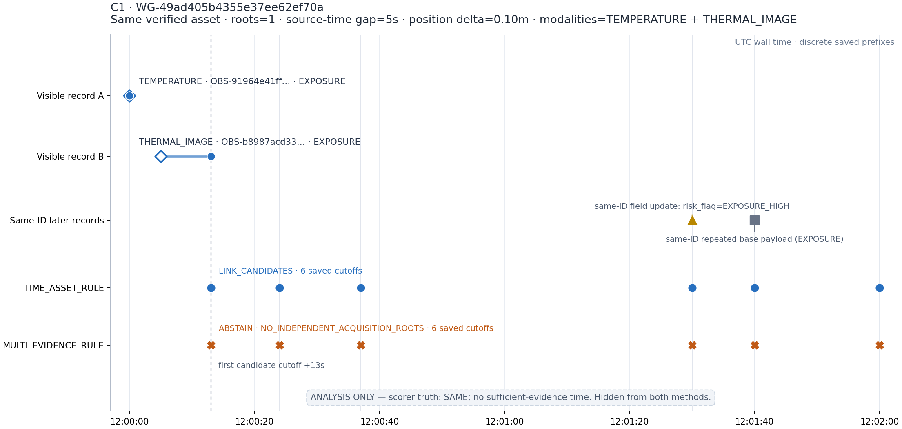
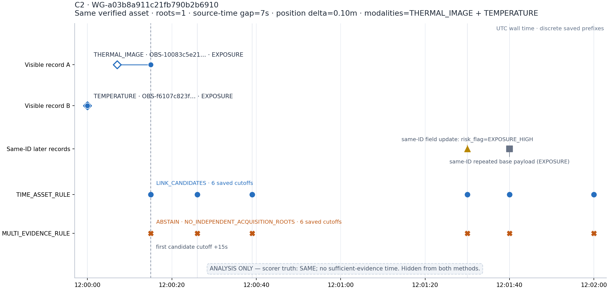

# Three same-event abstentions under a shared acquisition root

**Post-run analysis version 2 · 2026-10-11 · synthetic development only**

This report examines only the three already-scored `SAME` pairs where `TIME_ASSET_RULE` links and `MULTI_EVIDENCE_RULE` abstains. It reads the frozen attempt-02 input JSON, scorer sidecars, output traces, and saved outputs. It does not rerun or alter the generator, methods, scorer, evaluation configuration, metrics, or original reports. The source run manifest is [`comparison_attempt_02/run_manifest.json`](../comparison_attempt_02/run_manifest.json), SHA-256 `ff5411c0c498e1316255e673f2bbe9c5684a05c844ecff353f812b42f124b60d`.

## Corrections to the historical report

The original [`comparison_attempt_02/REPORT.md`](../comparison_attempt_02/REPORT.md) is preserved with its original hash. This version supersedes two narrative phrases:

- The method outputs are **not identical**. The delay summaries and censoring counts match, but these three pairs differ at every saved cutoff after candidacy: `TIME_ASSET_RULE → LINK_CANDIDATES`; `MULTI_EVIDENCE_RULE → ABSTAIN` (`NO_INDEPENDENT_ACQUISITION_ROOTS`).
- Attempt 01 falsely flagged **nine worlds across three non-UNKNOWN strata** (three worlds per stratum), not nine strata. Its sparse `Counter` omitted the explicit `UNKNOWN: 0` key expected by the audit. Neither method ran in attempt 01.

The two delay summaries are equal: both arms have 54 observed decisions after sufficient evidence, all with 0-second measured delay; 12 right-censored after sufficient evidence; 3 right-censored before sufficient evidence; and 3 UNKNOWN pairs excluded. These three disagreements are the three pre-evidence censored pairs. Equal delay summaries do not imply equal method outputs.

## Pair-by-pair visible evidence and method behavior

| Case | World | Pair (short IDs) | Modalities | Same verified asset | Source-time gap | Position delta | Value delta / allowance | Distinct roots | First candidate cutoff |
|---|---|---|---|---:|---:|---:|---:|---:|---|
| C1 | `WG-49ad405b4355e37ee62ef70a` | `OBS-91964…` ↔ `OBS-b8987…` | TEMPERATURE + THERMAL_IMAGE | Yes | 5 s | 0.10 m | 0.427 / 3.5 °C | 1 | 12:00:13Z |
| C2 | `WG-a03b8a911c21fb790b2b6910` | `OBS-10083…` ↔ `OBS-f6107…` | THERMAL_IMAGE + TEMPERATURE | Yes | 7 s | 0.10 m | 0.355 / 3.5 °C | 1 | 12:00:15Z |
| C3 | `WG-c6351b2c67706558c964473e` | `OBS-0cd8…` ↔ `OBS-f32d…` | THERMAL_IMAGE + TEMPERATURE | Yes | 6 s | 0.10 m | 0.900 / 3.5 °C | 1 | 12:00:14Z |

In all three pairs both base records have `risk_flag=EXPOSURE`, `quality_status=GOOD`, `calibration_status=CURRENT`, `asset_binding_status=VERIFIED`, position error 0.25 m, and value error 0.5 °C. The visible values are within the synthetic comparison envelope (sum of both value errors plus the fixed 2.5 °C tolerance). The `MULTI_EVIDENCE_RULE` code path passes its quality/calibration, cross-modal, abnormal-risk, and common time/position checks, then returns at the one-root guard before evaluating the value check. Thus the recorded rejection reason is the missing independent acquisition root; the value comparison is an offline analysis of visible fields, not a method-emitted reason.

The following are the method-visible base-record values (source and receipt times are UTC):

| Case | Observation A | Observation B | Shared visible asset / lineage |
|---|---|---|---|
| C1 | `OBS-91964e41ff8667328399`: TEMPERATURE, source/received 12:00:00Z, position `[0.0, 0.0]` m, `79.9502 ± 0.5 °C` | `OBS-b8987acd3368ef907868`: THERMAL_IMAGE, source 12:00:05Z / received 12:00:13Z, position `[0.1, 0.0]` m, `80.3772 ± 0.5 °C` | `ASSET-a4b725e769ab69de3da0` / `ROOT-98f66c61551a05cea7ec` |
| C2 | `OBS-10083c5e213e53917142`: THERMAL_IMAGE, source 12:00:07Z / received 12:00:15Z, position `[0.1, 0.0]` m, `80.2917 ± 0.5 °C` | `OBS-f6107c823fc32e05c1f1`: TEMPERATURE, source/received 12:00:00Z, position `[0.0, 0.0]` m, `79.9366 ± 0.5 °C` | `ASSET-e049e3802b7c5e601d89` / `ROOT-3d9b9754a3851c275c0b` |
| C3 | `OBS-0cd8d85f9e6d947750ef`: THERMAL_IMAGE, source 12:00:06Z / received 12:00:14Z, position `[0.1, 0.0]` m, `80.6684 ± 0.5 °C` | `OBS-f32de63fdc9bb280df1b`: TEMPERATURE, source/received 12:00:00Z, position `[0.0, 0.0]` m, `79.7685 ± 0.5 °C` | `ASSET-536525780aa151e606a7` / `ROOT-98a252e45d6a8b2e250f` |

Each pair’s exact two observation IDs, reason codes, per-cutoff traces, same-ID updates, and earliest-known timestamps are retained in [`case_analysis_data.json`](case_analysis_data.json).

| Case | Full pair IDs | Shared visible root | TIME_ASSET_RULE | MULTI_EVIDENCE_RULE | Saved decision snapshots |
|---|---|---|---|---|---:|
| C1 | `OBS-91964e41ff8667328399` ↔ `OBS-b8987acd3368ef907868` | `ROOT-98f66c61551a05cea7ec` | `LINK_CANDIDATES`: `VERIFIED_ASSET_MATCH`, `TIME_AND_POSITION_COMPATIBLE` | `ABSTAIN`: `NO_INDEPENDENT_ACQUISITION_ROOTS` | 6 per arm |
| C2 | `OBS-10083c5e213e53917142` ↔ `OBS-f6107c823fc32e05c1f1` | `ROOT-3d9b9754a3851c275c0b` | `LINK_CANDIDATES`: `VERIFIED_ASSET_MATCH`, `TIME_AND_POSITION_COMPATIBLE` | `ABSTAIN`: `NO_INDEPENDENT_ACQUISITION_ROOTS` | 6 per arm |
| C3 | `OBS-0cd8d85f9e6d947750ef` ↔ `OBS-f32de63fdc9bb280df1b` | `ROOT-98a252e45d6a8b2e250f` | `LINK_CANDIDATES`: `VERIFIED_ASSET_MATCH`, `TIME_AND_POSITION_COMPATIBLE` | `ABSTAIN`: `NO_INDEPENDENT_ACQUISITION_ROOTS` | 6 per arm |

Both modalities are present in each pair, but both observations descend from the **same single root**. `MULTI_EVIDENCE_RULE` reaches the independent-root guard and abstains. The repeated records do not raise the root count: at 12:01:30Z the same observation ID receives a one-field `EXPOSURE_HIGH` update, then at 12:01:40Z that ID appears again with its base `EXPOSURE` payload. These later records may be relevant risk updates/repeats, but the saved lineage remains one root; they are not independent acquisitions. The method outputs retain `independent_lineage_root_count=1` at all six post-candidate cutoffs.

### Case timelines

The diamonds mark source times; circles mark first receipt of each base observation. Later same-ID records are marked separately. Method points are discrete saved-prefix decisions, not a continuous state. The shaded footer is scorer-only analysis information and was not provided to either method.

## Scorer-only truth and what the conservatism shows

The following facts come only from the scorer sidecars. They are explicitly separated from the method-visible fields above:

| Case | Scorer-only relation | `first_sufficient_evidence_at` | Timing interpretation |
|---|---|---|---|
| C1 | SAME | `null` | Right-censored before sufficient evidence |
| C2 | SAME | `null` | Right-censored before sufficient evidence |
| C3 | SAME | `null` | Right-censored before sufficient evidence |

The extra abstentions are compatible with a conservative independence policy: they avoid treating two same-root modalities and repeated same-ID records as independent corroboration. But this development set **does not show an observed false-merge reduction**. The scorer labels all three underlying relations SAME, and neither arm made any false merges across the run. The three abstentions reduce coverage; they do not improve the measured false-merge rate here. Because the scorer records no sufficient-evidence time for these pairs, their hidden SAME labels also do not establish that a user could have known the association at those times. The safety payoff remains unobserved in this sample.

This is not evidence that the baseline’s early links were justified: truth and evidence sufficiency are separate. It is also not proof that the stricter rule is safer in production. The case traces show only that the current rule implementation enforces its one-root guard as written.

## Minimal next-batch counterexample design (not run)

Use four matched synthetic pair worlds as a small 2×2 control over event relation and acquisition independence. Keep the current fixed synthetic `InferenceConfig` and 120-second evaluation horizon unchanged; do not search thresholds or tune. Give the scorer a separate relation label and evidence-time schedule. Do not expose scorer fields to method inputs.

| Variant | Scorer-only relation | Observable lineage / clue construction | Intended check |
|---|---|---|---|
| R-SAME | SAME | Same-root pair with repeated, genuinely correct cross-modal risk clues; include a same-ID duplicate but no second root | Confirm repeated/correlated evidence leaves MULTI abstaining; mark evidence time unavailable until independent support arrives |
| R-DIFF | DIFFERENT | Byte-identical method-visible payload to R-SAME, so the repeated cue is misleading for identity | Negative control: both methods must see the same bytes; TIME_ASSET may link while MULTI abstains. A difference in scorer truth belongs only in scoring, not method features |
| I-SAME | SAME | Match R-SAME’s asset/time/position/quality facts, but source the corroborating modality from a second independent root | Test that valid independent support can satisfy the gate and that the decision appears at the registered evidence time |
| I-DIFF | DIFFERENT | Two distinct roots with otherwise compatible asset/time/position, quality, modality, and value cues, while external truth says distinct episodes | Adversarial control: tests whether independent roots alone can still produce a false merge; distinct roots are not event identity |

This is a design proposal only. It changes no current result, and no held-out data or follow-up run was accessed or executed.

## Reproducibility and limits

- Case facts are extracted by [`build_analysis.py`](build_analysis.py) from the saved attempt-02 JSON only; the script asserts the three pairs, one-root counts, actions, reasons, and scorer-sidecar values before plotting.
- [`case_analysis_data.json`](case_analysis_data.json) stores method-visible records/traces separately from scorer-only labels. Source attempt-02 run-manifest SHA-256 is recorded inside it.
- [`ANALYSIS_MANIFEST.json`](ANALYSIS_MANIFEST.json) binds the report, data, builder, and three figures by repository-relative path and SHA-256.
- Existing run parameters, metrics, 156 frozen method outputs, historical reports, and attempt-01 failure are unchanged. No model, network service, notification, Mac device, or untrusted runner was used.
- These are fixed synthetic development worlds; the correct/incorrect clue contrast proposed above has not been generated or scored. No new effect size or method ranking is claimed.
