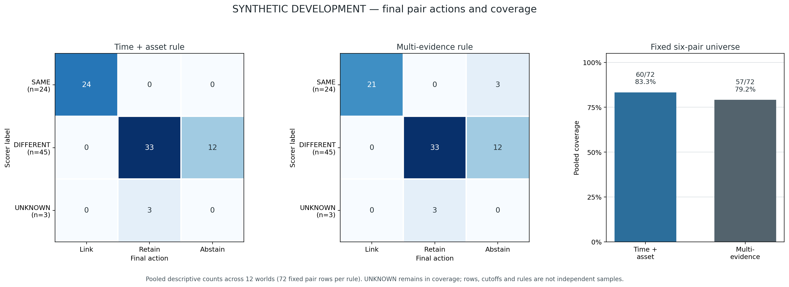
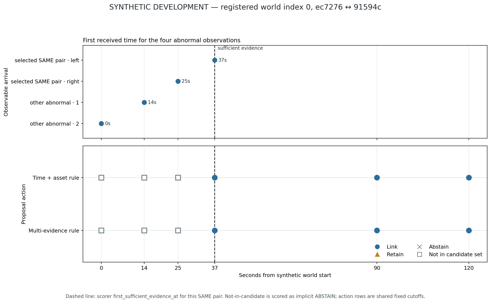

# SYNTHETIC DEVELOPMENT comparison — PASS_SYNTHETIC_DEVELOPMENT_ONLY

## Run identity

- Source commit: `c34d97e0101554a362e927ed9e3ff239cedc319e` on `task/research-three-v2-alignment-20261011`.
- Existing protocol status remains `REVIEW_DRAFT`; this single development run was explicitly authorized in the task handoff. It is a fixed-seed synthetic development comparison, not a formal or blind evaluation.
- Seed: `2026101101`; worlds: 12; allocation: {'independent_same_event': 3, 'adjacent_distinct_assets': 3, 'recovery_then_new_event': 3, 'dependent_replay_unknown': 3}; parameter searches: 0.
- Configuration SHA-256: `8cb45203d70180fed60b8a84be64d84d4b5bd1e39538b01e56b8b556c5b0e01a`.
- Integrity preflight: **PASS** with 0 failures. Failure artifact: [`failures.json`](failures.json).
- Inputs, frozen per-cutoff outputs, scorer sidecars, per-world scores, runtimes and chart data are stored alongside this report and bound by [`run_manifest.json`](run_manifest.json).
- Mac recovery instructions and repository-relative hashes for both preserved attempts are in [`MAC_PERSISTENCE_MANIFEST.json`](../MAC_PERSISTENCE_MANIFEST.json). The Mac is offline; this manifest is prepared but has not been applied there.

## Fixed comparison results

Pooled pair counts are descriptive across 12 worlds (72 unique pair rows per method); the protocol's primary summaries also show equal-world macro rates. A pair, cutoff, method arm or repeated rule call is not an independent world.

| Rule | False merge (DIFFERENT class) | False split (SAME class) | Coverage (all six pairs, UNKNOWN included) | UNKNOWN actions | Valid decision observed / evidence-eligible pairs | Rule calls (repeated prefix calls) |
|---|---:|---:|---:|---:|---:|---:|
| TIME_ASSET_RULE | 0/45 (0.0%; world macro 0.0%) | 0/24 (0.0%; world macro 0.0%) | 60/72 (83.3%; world macro 83.3%) | 3 ({'LINK_CANDIDATES': 0, 'RETAIN_SEPARATELY': 3, 'ABSTAIN': 0}) | 54/66 | 243 (183 repeated) |
| MULTI_EVIDENCE_RULE | 0/45 (0.0%; world macro 0.0%) | 0/24 (0.0%; world macro 0.0%) | 57/72 (79.2%; world macro 79.2%) | 3 ({'LINK_CANDIDATES': 0, 'RETAIN_SEPARATELY': 3, 'ABSTAIN': 0}) | 54/66 | 243 (183 repeated) |

UNKNOWN counts are not part of false-merge, false-split or evidence-after delay denominators. The UNKNOWN labels are synthetic masks over known relations, not an ambiguity-detection task.

### Delay and censoring

| Rule | Evidence-after eligible | Correct decision observed and delay | Right-censored after sufficient evidence | Right-censored before sufficient evidence | UNKNOWN excluded |
|---|---:|---|---:|---:|---:|
| TIME_ASSET_RULE | 66 | 54 (n=54, median 0.0s, mean 0.0s, range 0–0s) | 12 | 3 | 3 |
| MULTI_EVIDENCE_RULE | 66 | 54 (n=54, median 0.0s, mean 0.0s, range 0–0s) | 12 | 3 | 3 |

Observed delay is conditional on a registered sufficient-evidence time and a correct decision at or after that time. Censored rows remain reported; no survival model or SLO was applied. Shared-root SAME pairs are right-censored before sufficient evidence and are excluded from the evidence-after denominator.

### Calls and local runtime

| Rule | Function calls | Sum of instrumented rule-call time (seconds) | Median measured rule-call time (µs) |
|---|---:|---:|---:|
| TIME_ASSET_RULE | 243 | 0.055924 | 115.51 |
| MULTI_EVIDENCE_RULE | 243 | 0.077064 | 121.14 |

Maximum rule-call budget was 576 per arm. Runtime is local descriptive wall time with a lightweight timing wrapper; it is not a benchmark or performance claim. Repeated prefix calls are distinct computation, while the fixed unique-pair denominator remains 72 per method.

### Per-stratum descriptive counts

| Rule | Stratum | Worlds | False merges / DIFFERENT | False splits / SAME | Non-abstaining / fixed pairs |
|---|---|---:|---:|---:|---:|
| TIME_ASSET_RULE | dependent_replay_unknown | 3 | 0/9 | 0/6 | 18/18 |
| TIME_ASSET_RULE | adjacent_distinct_assets | 3 | 0/12 | 0/6 | 18/18 |
| TIME_ASSET_RULE | independent_same_event | 3 | 0/12 | 0/6 | 6/18 |
| TIME_ASSET_RULE | recovery_then_new_event | 3 | 0/12 | 0/6 | 18/18 |
| MULTI_EVIDENCE_RULE | dependent_replay_unknown | 3 | 0/9 | 0/6 | 15/18 |
| MULTI_EVIDENCE_RULE | adjacent_distinct_assets | 3 | 0/12 | 0/6 | 18/18 |
| MULTI_EVIDENCE_RULE | independent_same_event | 3 | 0/12 | 0/6 | 6/18 |
| MULTI_EVIDENCE_RULE | recovery_then_new_event | 3 | 0/12 | 0/6 | 18/18 |

## Figures

The timeline uses registered world index 0 selected before outcome inspection; its vertical line marks that pair's scorer-provided sufficient-evidence time.

Chart rendering printed the nonfatal warning `Fontconfig error: No writable cache directories`. The renderer exited successfully, both PNGs were written, and both were visually inspected. This warning does not affect the method outputs or scores; rendering performance was not benchmarked.

## Integrity and interpretation limits

- Two rules used the same fixed `InferenceConfig`, one frozen prefix per registered cutoff, and the same shared candidate set and prefix hash at each cutoff. The six-pair scoring universe was fixed from four abnormal observation IDs before method outputs; non-candidates score as implicit `ABSTAIN`.
- The preflight checked the exact development world ID/stratum/schedule registry, 12-world budget, three worlds per stratum, pair labels and six-pair universe, available times, lineage roots, cross-world ID/root/asset disjointness, exact replay behavior, and recovery markers. The run manifest hashes the frozen code, protocol and all saved artifacts.
- Both rules are deterministic synthetic functions over observable records. Current visible asset and recovery cues often explain the synthetic truth; boundary-adjacent difficulty is not systematically covered. Results describe these scripted worlds only.
- No heldout worlds, tuning, threshold changes, sample expansion, real field data, Mac repair, external notification, or old 1,464-check trial was run. Alert escalation remains `NOT_EVALUATED` because neither rule emits alert actions.
- No statistical test or method-superiority claim is made. Identical outputs, errors and censored observations are reported as generated.

## Execution totals

- Input generation in preserved attempt 01: 0.030353s (attempt 02 reused those saved inputs; it did not invoke the generator).
- Candidate/lineage preflight: 0.049618s.
- Combined rule execution across 12 worlds: 0.195385s.
- Scoring: 0.019439s; aggregation: 0.003624s.
- Plot generation: 2.338781s.
- Status: `PASS_SYNTHETIC_DEVELOPMENT_ONLY`; failure count: 0.

No additional evaluation was started after this comparison. Any next run requires a separate decision.

## Preserved first preflight attempt

The first invocation is retained at [`../run_manifest.json`](../run_manifest.json) with status `INVALID_RUN`. It generated and saved the same 12 development worlds but stopped before either rule ran. Its audit compared sparse `Counter` output to an expected mapping containing explicit zero counts, so it falsely flagged nine non-UNKNOWN strata. The raw generated inputs, scorer sidecars, candidate traces, failures and runtimes from that invocation remain hash-verified; this comparison reused those exact files and did not call the generator again.

The first attempt's manifest SHA-256 is `aa43cf0f174ce5cd2bb379c39682da47e5da695677a4dd68df3917c1d76e7c13`. No rule output from that attempt exists.
